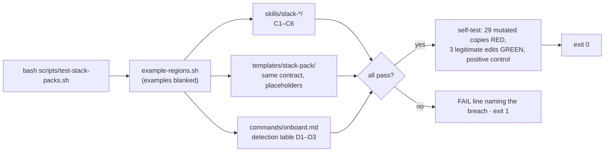

# Slice 083 — pack-contract

> Completed: 2026-11-09
> Commits: da8d388..ff12d36 (direct on main, no PR) · epic-006 entry `pack-contract`

## What

A stack-pack had no stated shape — `stack-php-laravel` was the only example. Now every `skills/stack-*/` is held to one
contract a machine checks: a pack that lacks the shape, keeps a template placeholder, or does not say what it rests on
and how old it is, turns `scripts/test-stack-packs.sh` red with a line naming the breach. A shipped template
`templates/stack-pack/` shows the shape for a user's own packs, and `/craft:onboard` now proposes Shopware 6, Shopware 5,
API Platform, Symfony and Bash packs, in precedence order.

## Why

- The eight packs of epic-006 are built from research, and their version claims age — so each pack is dated (`As of`)
  and cites its sources (the user's rule: training knowledge is never ground truth). The contract is defined once, in the
  harness header, and the template is checked against the same contract, so no second description can drift ("a rule is
  never described twice"). Recorded as D43.
- The detection table is written whole because precedence is a property of the whole table — Shopware 6 is a Symfony
  application and must be checked before Symfony. Its signals come from Packagist and the vendors' docs, not memory;
  that research found API Platform at 5.x and Symfony at 8.1.
- Walk-through: `bash scripts/test-stack-packs.sh` passes every file through `example-regions.sh` first, then checks each
  pack (C1–C6: frontmatter, section order, reference files in both directions, size budget, sources, no placeholder),
  the template the same way with placeholders allowed, and the detection table (coverage, seven precedence pairs,
  `stack-bash` directly above `none`, `none` last). The self-test plants one breach in each of 29 copies, each in a
  directory of its own, and expects red with the matching text; three legitimate edits stay green; an unchanged copy is
  the positive control (34 passed).
- Review round 1 (7 Light, all fixed in-phase) also exposed a defect in the harness itself: every mutation had shared
  one fixture directory, because `fixture()` ran in a command substitution and its counter never advanced. Each fixture
  now gets its own `mktemp` directory.

## Decisions

- **Contract form: template + harness** — the harness header is the one definition, the template a bound copy checked
  against the same contract (placeholders stand in for values). *Why not* a design document alone: prose is not
  checkable (intent.md, slice-031).
- **The whole detection table is written now** — precedence cannot be distributed across nine slices; names of packs not
  yet shipped are allowed in the table, and `/craft:prime` warns on a declared pack that is missing. Amends epic-006: the
  pack slices carry only the docs count/text, the README line and the CHANGELOG line. *Why not* one row per pack slice:
  each slice would have to know the whole order anyway.
- **stack-php-laravel is retrofitted, not exempted** — `## Sources` with `Basis: extraction` (extracted 2026-05-20, not
  re-verified; Laravel 13 has been released since). *Why not* an exception list: the contract would have a hole from
  day one. A re-verification of its content is out of scope.
- **Detection signals are researched, not recalled** — they went into the table in this slice, so the global
  verification rule applied here already.
- **Detection signals, verified 2026-11-09** — primary sources: the Packagist p2 API, Shopware's Plugin Base Guide,
  composer/installers' `ShopwareInstaller.php`, Shopware's Shopware 5 end-of-life page.
  - Shopware 6: a project requires `shopware/core` (`shopware/production` v6.7.16.0 requires `shopware/core`,
    `shopware/administration`, `shopware/storefront`); `shopware/platform` is the monorepo (named, or required); a plugin
    has `"type": "shopware-platform-plugin"` and requires `shopware/core`.
  - Shopware 5: the shop is the Composer project `shopware/shopware` (last release v5.7.20, 2025-06-05); plugins use
    composer/installers' `shopware-` types; end of life at the end of July 2024 — a maintenance pack for legacy shops.
  - API Platform: `api-platform/core` v5.0.6; `api-platform/symfony` (Symfony `^7.4 || ^8.0`) and
    `api-platform/laravel`; the legacy `api-platform/api-pack` (v1.4.0) requires the Symfony variant. Laravel precedes
    API Platform, so a Laravel app with `api-platform/laravel` gets `stack-php-laravel`.
  - Symfony: `symfony/framework-bundle` v8.1.11. Laravel: `laravel/framework` v13.40.0.
  - Bash: no manifest; a heuristic (`*.sh` scripts, a `.bats` suite or a `.shellcheckrc`) directly above `none`.
- **Detection precedence** — Shopware 6 → Shopware 5 → Laravel → API Platform → Symfony → plain PHP; the harness asserts
  the pairs Shopware 6 < Symfony, API Platform < Symfony, Laravel < API Platform, Symfony < plain PHP, Shopware 5 <
  plain PHP, Laravel < plain PHP, and Bash directly above none.
- **intent.md "D1–D42" → "D1–D43"** — promoted `[I]` in Phase 9; rules.md's harness count and list were changed in
  Phase 4 on the user's explicit yes.

## Commits

- `da8d388` — feat(onboard): detect Shopware, API Platform, Symfony and Bash stacks in precedence order
- `3250f44` — docs(decisions): bank D43 — a stack-pack is held to one checked contract
- `0293c19` — feat(skills): add a checked stack-pack contract and template
- `ff12d36` — docs: wire the stack-pack contract into the harness lists, docs site and changelog

(The first two landed before the contract commit: a word-splitting slip in the commit command made the first and last
attempts fail, and Phase 9 does not rewrite history.)

## How (Diagram)

